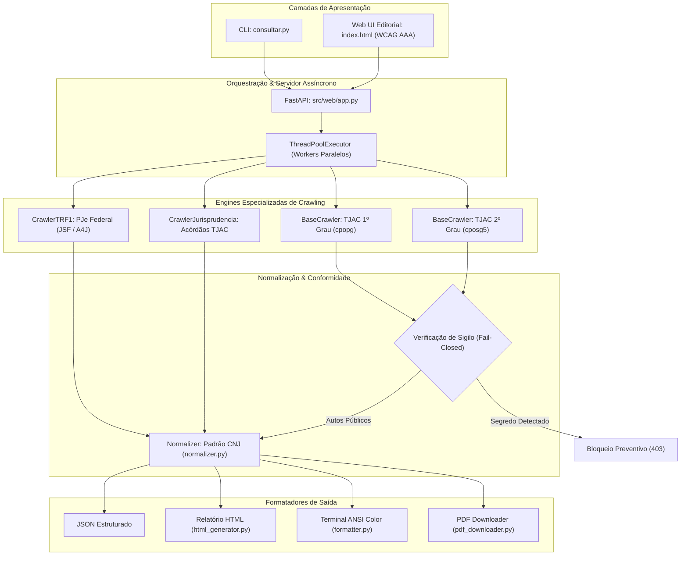

# LexNode — Engenharia de Dados & Inteligência Processual Pública

<p align="center">
  
</p>

<p align="center">
  <strong>Motor Cívico e Gratuito de Inteligência Jurídica, Extração OSINT e Normalização Processual do Judiciário Brasileiro</strong>
</p>

<p align="center">
  <a href="https://github.com/walbarellos/LexNode/actions"></a>
  <a href="https://www.python.org/downloads/release/python-3120/"></a>
  <a href="https://fastapi.tiangolo.com/"></a>
  <a href="https://pytest.org/"></a>
  <a href="https://www.w3.org/WAI/standards-guidelines/wcag/"></a>
  <a href="https://github.com/walbarellos/LexNode/blob/main/LICENSE"></a>
</p>

---

## 👨‍💻 Autor e Engenharia Principal

* **Engenheiro de Software & Autor:** **Willian Albarello**
* **GitHub Oficial:** [@walbarellos](https://github.com/walbarellos)
* **Repositório:** [https://github.com/walbarellos/LexNode](https://github.com/walbarellos/LexNode)
* **Contato Profissional:** [willianalbarello@gmail.com](mailto:willianalbarello@gmail.com)
* **Especialidades:** *Software Architecture, Distributed Web Crawlers, OSINT Intelligence, Reverse Engineering of Legacy Systems (JSF/e-SAJ/PJe), Clean Architecture, API Design.*

> *"A publicidade dos atos processuais é preceito constitucional indispensável ao Estado Democrático de Direito. O LexNode foi concebido para transformar dados dispersos em informação transparente, acessível e estruturada para qualquer cidadão, sem barreiras de monetização."*  
> — **Willian Albarello**

---

## 🏛️ Visão Geral & Filosofia

O **LexNode** (concebido como a evolução aberta e 100% gratuita de plataformas fechadas como o Jusbrasil) é uma solução de software de alta performance desenvolvida em **Python** voltada à investigação de fontes abertas (**OSINT**), transparência judicial e raspagem estruturada de dados processuais.

Diferente de scrapers convencionais que quebram facilmente ou atuam de forma destrutiva contra a infraestrutura pública, o LexNode implementa **engenharia reversa ética e resiliente**, respeitando limites operacionais dos tribunais, mapeando o DOM de sistemas legados complexos e consolidando múltiplas esferas jurisdicionais em esquemas unificados no padrão do **Conselho Nacional de Justiça (CNJ)**.

### Pilares Fundamentais:
1. **Acesso Público Irrestrito:** Consulta a processos, partes e movimentações sem planos de assinatura, cobranças ou paywalls.
2. **Engenharia Resiliente:** Tratamento de ViewStates dinâmicos em JavaServer Faces (JSF) do PJe e gerenciamento de sessões do e-SAJ.
3. **Resolução Interativa de Segurança (Captcha Handshake):** Mecanismo de fallback em HTTP 428 que permite ao próprio usuário resolver eventuais verificações do tribunal em 1 clique sem perda de estado.
4. **Privacy by Design & Fail-Closed:** O sistema opera estritamente sobre autos públicos. Qualquer indício de segredo de justiça é tratado na origem em conformidade com a LGPD e resoluções do CNJ.

---

## 📐 Arquitetura de Software & Pipeline de Dados

O LexNode segue o princípio da **Arquitetura em Camadas (Layered Architecture)** com responsabilidade única por módulo (*Single Responsibility Principle*):



---

## 🔬 Engenharia Reversa e Técnicas de Raspagem

### 1. e-SAJ Estadual (TJAC — 1º e 2º Grau)
* **Arquivos do núcleo:** [`src/base_crawler.py`](./src/base_crawler.py) e [`src/normalizer.py`](./src/normalizer.py)
* **Sessão e Cookies:** O crawler efetua handshake inicial em `/cpopg/open.do` ou `/cposg5/open.do`, coletando cookies de afinidade para mitigar rejeições imediatas.
* **Rate Limiting Humano:** Intervalo mínimo monitorado via `time.monotonic()` para evitar bloqueios por IP e mitigar sobrecarga no Judiciário.
* **Formatação CNJ Bidirecional:** Decomposição algorítmica do número único (`NNNNNNN-DD.AAAA.J.TR.OOOO`) em `numeroDigitoAnoUnificado` e `foroNumeroUnificado`.

### 2. PJe Federal (TRF1 — Processo Judicial Eletrônico)
* **Arquivo do núcleo:** [`src/crawler_trf1.py`](./src/crawler_trf1.py)
* **Desafio Técnico:** O PJe é estruturado em **JavaServer Faces (JSF)** com **RichFaces / Ajax4jsf (A4J)**, exigindo manipulação estrita de campos de estado dinâmico (`javax.faces.ViewState`).
* **Protocolo A4J:** O LexNode simula o payload assíncrono `AJAX:EVENTS_COUNT` e `A4J.AJAX.Submit`, decodificando XML/HTML sob demanda para extrair partes, polo ativo/passivo e movimentações com paginação.

### 3. Inteligência Anti-Captcha & Resolução em 1 Clique
* **Heurística Estrutural:** A checagem de captcha em [`src/base_crawler.py`](./src/base_crawler.py) analisa elementos ativos (`class="g-recaptcha"`, `/sysgen/captcha.do`, `h-captcha`), eliminando falsos positivos provocados por trechos normais de JavaScript (como referências a variáveis `uuidCaptcha`).
* **Fluxo HTTP 428:** Caso o firewall do tribunal imponha um desafio ativo, o backend devolve status `428 Precondition Required`. A interface web em [`src/web/templates/index.html`](./src/web/templates/index.html) exibe um painel de validação oficial com botão **"Já validei, tentar novamente"**, preservando os dados digitados e executando a consulta em tempo real sem recarregar a página.

---

## 🛡️ Segurança, Conformidade e Segredo de Justiça

> *"Todos têm direito a receber dos órgãos públicos informações de seu interesse particular, ou de interesse coletivo ou geral [...] ressalvadas aquelas cujo sigilo seja imprescindível à segurança da sociedade e do Estado."*  
> — **Constituição da República Federativa do Brasil de 1988, Art. 5º, XXXIII**

O LexNode adota o paradigma **Privacy by Design** formulado pela Dra. Ann Cavoukian, implementando a seguinte diretriz de segurança:
* **Fail-Closed em Sigilo:** Implementado em [`src/normalizer.py`](./src/normalizer.py). O sistema inspeciona se há sinalização de restrição processual (`ProcessoSigilosoError`).
* **Tratamento de Falsos Positivos de Menu:** O parser descarta textos institucionais padrão contidos em tooltips (ex.: avisos genéricos sobre senha de balcão), garantindo que apenas autos formalmente sob segredo sejam resguardados.
* **Não Armazenamento de Dados Sensíveis:** O sistema consulta a informação em tempo real na fonte pública oficial, garantindo aderência à Lei Geral de Proteção de Dados (Lei nº 13.709/2018 - LGPD).

---

## 📂 Mapeamento de Arquivos e Componentes

| Arquivo | Camada | Descrição Técnica |
|---|---|---|
| [`consultar.py`](./consultar.py) | CLI | Interface de linha de comando com suporte a argumentos CLI (`--doc`, `--nome`, `--juris`, `--html`, `--json`). |
| [`src/base_crawler.py`](./src/base_crawler.py) | Engine / Crawler | Sessão HTTP resiliente para o e-SAJ TJAC (1º e 2º grau), rate limit e detecção apurada de captchas. |
| [`src/crawler_trf1.py`](./src/crawler_trf1.py) | Engine / Crawler | Crawler para o PJe da Justiça Federal (TRF1), com engenharia reversa de ViewState e submissões A4J. |
| [`src/crawler_jurisprudencia.py`](./src/crawler_jurisprudencia.py) | Engine / Crawler | Motor de raspagem textual para ementas e acórdãos do Tribunal de Justiça. |
| [`src/normalizer.py`](./src/normalizer.py) | Data Pipeline | Parser lxml/BeautifulSoup, mapeamento de DOM, tipagem dataclass e filtro fail-closed de sigilo. |
| [`src/pdf_downloader.py`](./src/pdf_downloader.py) | Storage / Scraping | Extração e download autenticado de peças processuais e acórdãos em formato PDF. |
| [`src/formatter.py`](./src/formatter.py) | Presentation | Formatação rica de terminal em cores ANSI, resumos e tabelas para a CLI. |
| [`src/html_generator.py`](./src/html_generator.py) | Presentation | Geração de relatórios analíticos em HTML para inteligência OSINT e investigações. |
| [`src/web/app.py`](./src/web/app.py) | Web API | Servidor FastAPI assíncrono com ThreadPoolExecutor, health checks, rotas `/v1/models` e tratamento 428. |
| [`src/web/templates/index.html`](./src/web/templates/index.html) | Frontend | Interface editorial inspirada em periódicos jurídicos, semântica WCAG AAA, navegação por teclado e cards de captcha. |
| [`tests/test_base_crawler.py`](./tests/test_base_crawler.py) | Test Suite | Testes unitários para formatação CNJ e testes de detecção de desafios de segurança. |
| [`tests/test_normalizer_sigilo.py`](./tests/test_normalizer_sigilo.py) | Test Suite | Testes de integridade do filtro de sigilo fail-closed e integridade de extração. |
| [`TODO.md`](./TODO.md) | Documentação | Roadmap de engenharia futura (BNMP, TRT14, SQLite persistente e Playwright Headless). |

---

## 💻 Guia de Uso — Linha de Comando (CLI)

O arquivo [`consultar.py`](./consultar.py) é o ponto de entrada principal para operações no terminal:

```bash
# 1. Investigação por CPF ou CNPJ (Busca unificada em 1º Grau, 2º Grau e TRF1)
python consultar.py --doc 11669325000188

# 2. Pesquisa nominal com exportação de dossiê em HTML
python consultar.py --nome "Ympactus Comercial" --html --detalhar

# 3. Consulta direta de processo por número unificado (CNJ)
python consultar.py 0701300-79.2019.8.01.0003

# 4. Busca textual de Jurisprudência e download automatizado de Acórdãos em PDF
python consultar.py --juris "dano moral inscrição indevida" --baixar-pdfs

# 5. Serialização de dados em JSON para integração com Datalakes ou pipelines externos
python consultar.py --doc 00000000000 --json > resultado_alvo.json
```

---

## 🌐 Interface Web Editorial (FastAPI)

A interface em [`src/web/templates/index.html`](./src/web/templates/index.html) rompe com templates genéricos de dashboards e adota o estilo **editorial de imprensa jurídica**:
* **Acessibilidade:** Padrão WCAG AAA com proporção de contraste superior a 7:1.
* **Navegação por Teclado:** Controle de foco (`:focus-visible`), saltos acessíveis (`.skip`) e suporte a leitores de tela com `aria-live` e `aria-busy`.
* **Semântica HTML5:** Marcação semântica com `<article>`, `<dl>`, `<dt>`, `<dd>`, `<time>` e listas ordenadas cronológicas.

Para executar o servidor web localmente:
```bash
./start.sh
# Ou diretamente:
uvicorn src.web.app:app --host 0.0.0.0 --port 8000 --reload
```
Acesse: `http://localhost:8000`

---

## ☁️ Guia de Implantação (Deployment no Render)

O LexNode foi projetado para execução contínua com Uvicorn (evitando limitações de *timeout de 10 segundos* presentes em ambientes serverless como Vercel ou Netlify).

### Deploy no Render:
1. Conecte o repositório GitHub (`walbarellos/LexNode`) ao dashboard do [Render](https://dashboard.render.com/).
2. Crie um novo **Web Service**.
3. Defina as configurações de inicialização:
   * **Runtime:** `Python 3`
   * **Build Command:** `pip install -r requirements.txt`
   * **Start Command:** `uvicorn src.web.app:app --host 0.0.0.0 --port $PORT`
4. A aplicação estará ativa em ambiente HTTPS de alta disponibilidade.

---

## 🧪 Testes Automatizados & Qualidade de Código

A suíte de testes unitários garante que regras de sigilo processual e parsers estruturais nunca sofram regressões:

```bash
# Execução da suíte completa de testes
pytest -v

# Execução com medição de tempo e saída detalhada
pytest -s tests/test_normalizer_sigilo.py
```

---

## 📜 Citações & Referências Normativas

* **Constituição da República Federativa do Brasil de 1988:** *Art. 93, inciso IX (Publicidade das decisões e atos do Poder Judiciário).*
* **Lei nº 12.527/2011 (Lei de Acesso à Informação - LAI):** *Garantia do acesso público a informações produzidas ou custodiadas pelo Estado brasileiro.*
* **Conselho Nacional de Justiça (CNJ):** *Resolução nº 121/2010 (Normas para divulgação de dados processuais eletrônicos na rede mundial de computadores).*
* **Cavoukian, Ann (2009):** *Privacy by Design: The 7 Foundational Principles. Information and Privacy Commissioner of Ontario.*
* **Martin, Robert C. (2017):** *Clean Architecture: A Craftsman's Guide to Software Structure and Design. Prentice Hall.*

---

## 📄 Licença e Uso Ético

Distribuído sob a licença **MIT**. Veja [`LICENSE`](./LICENSE) para detalhes.  
Este projeto destina-se a fins cívicos, acadêmicos, jornalísticos e de pesquisa em inteligência de fontes abertas (OSINT). O uso automatizado deve respeitar os princípios da proporcionalidade, sem sobrecarregar intencionalmente os sistemas de tecnologia do Judiciário brasileiro.

---

<p align="center">
  <strong>LexNode</strong> · Desenvolvido com rigor de engenharia por <strong><a href="https://github.com/walbarellos">Willian Albarello</a></strong>
</p>
